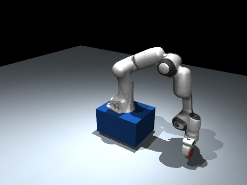
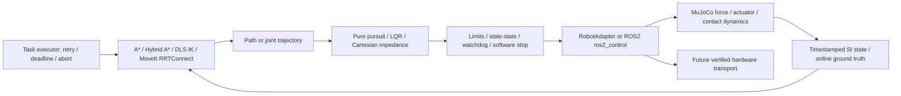
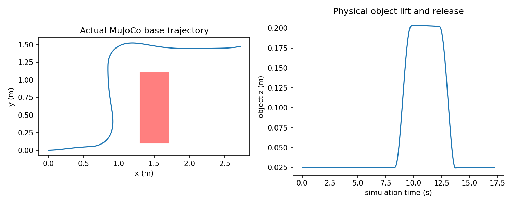
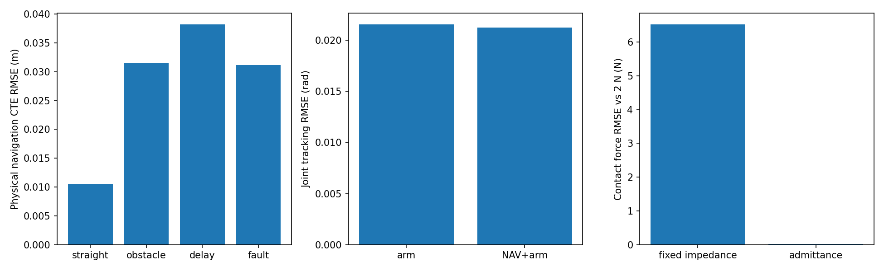

# EmbodiedSwarm

**Navigation, manipulation and safety for a mobile robot, verified in real MuJoCo physics and ROS2 before hardware integration.**

The stack turns a task into a navigation path, bounded arm motion, actuator commands and monitored execution. A standard Franka Panda model physically grips, lifts and releases an object on a force-actuated mobile base in one MuJoCo world after a fixed straight approach. Separate physical A* navigation experiments verify obstacle avoidance. A separately tested ROS2/MoveIt2 pipeline plans and executes Panda trajectories through a MuJoCo topic bridge.

**Stage: verified software components / pending physical validation.** Local evidence: **220 Python tests**, **4 C++ GoogleTests**, **4 ASan/UBSan tests**, 30 C++/Python numerical parity cases, **40 real-physics benchmark runs** across five seeds, and actual ROS2/MoveIt2 execution. The broader roadmap contains 12 accepted milestone groups and 4 partial groups; this is a measured software stage, not a claim of complete hardware commissioning, Raspberry Pi HIL or multi-robot deployment validation.

[中文导航](docs/README_ZH.md) · [Baseline audit](docs/BASELINE_AUDIT.md) · [Benchmark](docs/SIMULATION_BENCHMARK.md) · [Hardware guide](docs/HARDWARE_READINESS.md) · [Delivery matrix](docs/FINAL_DELIVERY_REPORT.md) · [Interview guide](docs/INTERVIEW_TECHNICAL_GUIDE.md) · [ROS2 evidence](docs/ROS2_ACCEPTANCE.md)



[Actual NAV → GRASP → PLACE GIF](artifacts/physical/mobile_task_visual_seed_7.gif) · [Navigation GIF](artifacts/physical/navigation_obstacle_seed_7.gif) · [Fixed-base grasp GIF](artifacts/physical/pick_place_seed_7.gif)

## Architecture



`RobotState` / `RobotCommand` use world-frame base pose, body-frame twist, radians, meters and simulation seconds. Algorithm modules stay independent of transport. Mock, legacy kinematic simulation, real physics and future hardware are explicitly distinguished.

## Implemented and tested

| Area | Implementation | Evidence / boundary |
|---|---|---|
| Navigation | Dijkstra, A*, forward Hybrid A*, collision-aware smoothing, pure pursuit, LQR, reactive replanning | Existing unit/demo coverage; force-driven MuJoCo regression uses A* + pursuit |
| Arm kinematics | Independent NumPy FK, geometric Jacobian, adaptive damped least squares IK, joint limits, manipulability | Cross-checked against `mj_forward`, `mj_jacSite`, finite differences and C++ |
| Physical manipulation | Licensed upstream Panda, affine position actuators, two physical fingers, free object, frictional contact | 5/5 fixed-base and 5/5 same-world mobile tasks; no grasp weld or object teleportation |
| Task framework | NAVIGATE → LOCALIZE → PLAN → GRASP → LIFT → MOVE → PLACE → RELEASE → VERIFY | Success criteria, fresh-state retries, timeout, recovery and abort; physical failed-grasp retry tested |
| Control | Joint tracking, Cartesian torque impedance, bias compensation, force admittance | Floor-contact and 2 Nm disturbance experiment; saturation enforced |
| Safety | Finite input/config checks, norm speed/yaw limits, geofence, command/state freshness, latched software stop, bounded joint targets/slew, reset policy | Unit boundaries and physical stale-command/recovery tests |
| C++17 | Panda FK/Jacobian, pursuit target control, saturated impedance | CMake, Eigen, GoogleTest, warnings as errors, ASan/UBSan and numerical parity |
| ROS2 | Humble, TF2, URDF/Xacro, JointState, topic/service/action, controller manager, ros2_control, MoveIt2/OMPL RRTConnect, bag replay | Actual WSL build and MuJoCo trajectory execution; details in ROS2 report |
| Engineering | CI workflow, source/wheel asset installation, JSONL logs, telemetry, profiling, commissioning, software release selection/rollback | Local checks executed; remote CI outcome is reported separately |
| Learning, P1 | Actual clipped PPO on bounded Cartesian target residual in MuJoCo contact | 7,680 training control steps, weights, reward curve, three held-out seeds and stiffness OOD evaluation |

## Measured results

Five fixed seeds: `7, 17, 27, 37, 47`; no rendering during performance collection. Values below are means of per-run metrics. Full configurations, sample counts and raw logs are in the [benchmark report](docs/SIMULATION_BENCHMARK.md).

| Experiment | Result |
|---|---:|
| Navigation straight / obstacle / 100 ms delay / stale-command recovery | 20/20 success; 0 obstacle contact steps |
| Path tracking RMSE, straight / obstacle / delay / fault | 0.0106 / 0.0315 / 0.0382 / 0.0312 m |
| Fixed-base physical grasp/place | 5/5 success; 0.02139 rad joint RMSE |
| One-world mobile NAV → grasp/place | 5/5 success; 0.02127 rad joint RMSE |
| Injected failed grasp | Actual open-finger failure, 1 recovery, task success |
| Reachable IK pose experiments | 100/100; max position error 0.000199 m |
| Contact force RMSE vs 2 N: fixed impedance → admittance | 6.525 → 0.0300 N |
| FK + Jacobian runtime P50: Python → C++ release | 363.675 → 0.758 μs, 10,000 calls each |
| ROS2/MoveIt physical trajectory max joint error | 0.000892 rad |
| Nominal ROS same-host stamp-to-callback P50 / P95 / P99 | 0.515 / 0.850 / 1.581 ms, 166 samples; repeat P99 5.959 ms |




PPO improved nominal contact force RMSE from about 6.52 to 0.49 N, but classical force admittance achieved 0.03 N in its steady-state test. Learning is an experimental comparison, not the default controller. [Actual training and OOD results](artifacts/learning/residual_ppo.json) · [weights](artifacts/learning/residual_ppo.pt) · [reward/OOD plot](artifacts/learning/residual_ppo.png).

## Environment setup

Verified host: Windows + WSL2 Ubuntu 22.04, Python 3.10.12, MuJoCo 3.12.0, GCC 11.4, ROS2 Humble, EGL headless rendering. Exact original installed package versions are retained in the evidence. A fresh installation resolves declared dependencies; the source repository and wheel both include required licensed robot assets.

```bash
git clone https://github.com/Leo-7GOAT/EmbodiedSwarm.git
cd EmbodiedSwarm
python3 -m venv .venv
source .venv/bin/activate
python -m pip install -e ".[dev,demo,profiling]"
export MUJOCO_GL=egl
```

For C++ install the platform's CMake, Eigen3 and GoogleTest development packages. ROS2 setup/build commands are in [the ROS2 acceptance guide](docs/ROS2_ACCEPTANCE.md); ROS execution uses the Ubuntu/WSL environment, not a Python publisher mock.

## Quick start

From the repository root:

```bash
# Real force-actuated base, navigation and software fault recovery
python -m demos.physical_navigation --scenario fault --seed 7

# Navigation + physical grasp/place in one engine world
python -m demos.mobile_manipulation --seed 7 --render
python -m demos.mobile_manipulation --seed 7 --grasp-fault

# Physical floor contact with feedback force control
python -m demos.impedance_contact --admittance --seed 7

# All 40 physical benchmark runs + figures + 100 IK targets
python -m demos.benchmark
```

`--render` requires functioning EGL/OpenGL; headless physical simulation needs no renderer. Object localization and occupancy geometry use explicitly labeled simulator ground truth. A rendered run has higher wall time than headless benchmarking.

## Tests and C++

```bash
cmake -S cpp -B cpp/build -DCMAKE_BUILD_TYPE=Release
cmake --build cpp/build -j4
ctest --test-dir cpp/build --output-on-failure
python -m pytest -q
python -m demos.core_benchmark

cmake -S cpp -B cpp/build-sanitize -DENABLE_SANITIZERS=ON -DCMAKE_BUILD_TYPE=Debug
cmake --build cpp/build-sanitize -j4
ctest --test-dir cpp/build-sanitize --output-on-failure
```

The parity test checks 30 random joint configurations against the built CLI; build C++ first so it runs rather than skips. Sanitizers were exercised on WSL/Linux. The GitHub workflow is versioned; local execution evidence does not by itself imply a remote CI pass.

Optional learning reproduction:

```bash
python -m pip install -e ".[learning,demo]"
python -m demos.train_residual_ppo --seed 7 --updates 30
```

## Hardware integration and limitations

- **PENDING_HARDWARE:** no real controller, wheelbase, motor driver, encoder, IMU, Raspberry Pi or physical E-stop was validated. Unknown manufacturer protocol/calibration fields remain null; no R550 serial/CAN format is invented.
- The physical mobile base uses planar generalized force/velocity servos. It exhibits inertia, actuator force limits and contact response, but is not a wheel-ground slip or specific drivetrain model.
- The Panda model is pinned licensed MuJoCo Menagerie geometry/dynamics. Simulator ground truth supplies localization. There is no camera perception, hardware calibration, payload identification or validated contact-force sensor.
- Hybrid A* is forward-only; occupancy collision checks require footprint inflation. Physical navigation uses conservative inflated obstacles. Task orchestration is sequential with bounded recovery, not a general symbolic TAMP solver.
- The stable ROS bridge executes arm trajectories. The integrated mobile task currently runs directly in MuJoCo with a fixed straight navigation approach; flexible obstacle task planning and distributed ROS navigation plus manipulation orchestration are later integration steps.
- Software stop, bag replay and local timing measurements do not certify braking distance, real-time guarantees or hardware HIL.
- Despite the project name, multi-robot coordination/MAPPO is not implemented or claimed.

See [hardware readiness](docs/HARDWARE_READINESS.md) and [commissioning tools](tools/hardware/README.md) for configuration, encoder/IMU logging, response identification, latency measurement, safe deployment selection and rollback.

## Engineering lessons

The initial adapter called MuJoCo but overwrote the base state after every physics step and exposed a logical gripper. Preserving its legacy tests while adding an independent physical backend prevented a false integration claim. Contact experiments also showed that a sudden Cartesian target step causes force spikes: gradual target motion and bounded residual slew were necessary before PPO evaluation. Latched safety recovery requires a fresh stationary state; simply receiving a new command is insufficient.

## Model attribution

Franka Panda assets: [Google DeepMind MuJoCo Menagerie](https://github.com/google-deepmind/mujoco_menagerie/tree/0059d4335f8156206f63a35662313385f7ad6d74/franka_emika_panda), revision `0059d4335f8156206f63a35662313385f7ad6d74`. Upstream files are unchanged in `assets/franka_emika_panda/`; [license](assets/franka_emika_panda/LICENSE) and provenance JSON are retained. Project-specific scenes mount that model and add physical objects/ground/base actuators.
