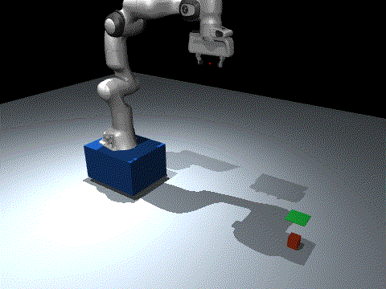
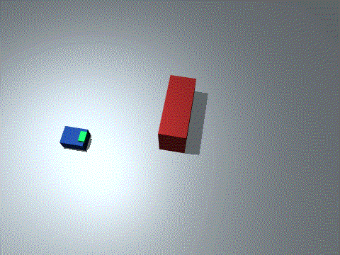
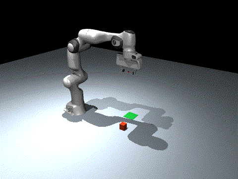
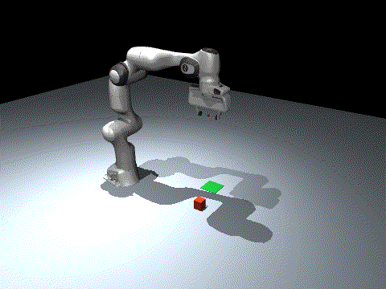
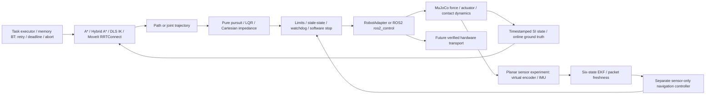

# EmbodiedSwarm

[](https://github.com/Leo-7GOAT/EmbodiedSwarm/actions/workflows/software.yml)
[](https://github.com/Leo-7GOAT/EmbodiedSwarm/actions/workflows/ros2.yml)

**Navigation, manipulation and safety for a mobile robot, verified in real MuJoCo physics and ROS2 before hardware integration.**

The stack turns a task into a navigation path, bounded arm motion, actuator commands and monitored execution. A standard Franka Panda model physically grips, lifts and releases an object on a force-actuated mobile base in one MuJoCo world after a fixed straight approach. Separate physical A* navigation experiments verify obstacle avoidance. A separately tested ROS2/MoveIt2 pipeline plans and executes Panda trajectories through a MuJoCo topic bridge.

**Stage: verified software components / pending physical validation.** Local evidence: **268 Python tests**, **4 C++ GoogleTests**, **4 ASan/UBSan tests**, 30 C++/Python numerical parity cases, **40 real-physics benchmark runs**, **20 sensor-feedback navigation runs and 5 safe aborts**, **30 behavior-tree acceptance cases**, and actual ROS2/MoveIt2 execution. The original 16 milestone groups contain **13 accepted / 3 partial (81.25% by milestone count)**. Each experiment has its own measured scope; hardware commissioning, Raspberry Pi HIL and full distributed mobile-task integration remain pending.

[Baseline audit](docs/BASELINE_AUDIT.md) · [Benchmark](docs/SIMULATION_BENCHMARK.md) · [Sensor estimation](docs/STATE_ESTIMATION_ACCEPTANCE.md) · [Behavior tree](docs/BT_ACCEPTANCE.md) · [Hardware guide](docs/HARDWARE_READINESS.md) · [Delivery matrix](docs/FINAL_DELIVERY_REPORT.md) · [Interview guide](docs/INTERVIEW_TECHNICAL_GUIDE.md) · [ROS2 evidence](docs/ROS2_ACCEPTANCE.md)

## Watch the real MuJoCo tests

Actual engine-rendered recordings, shown inline as looping GIFs. Motion uses force/position actuators and physical contacts; objects are not welded to the fingers or teleported during execution. These are separate experiments with the boundaries stated below.

| **Navigate → grasp → place · seed 7** | **Navigation around an obstacle · seed 7** |
|---|---|
|  |  |
| The base approaches, the Panda physically grips/lifts the free object, then releases at the goal. **5/5** mobile tasks pass; fixed straight approach, truth object localization. [Task metrics](artifacts/physical/mobile_task_visual_seed_7.json). | A* and pure pursuit drive the force-actuated base around an inflated static obstacle. **5/5** obstacle runs pass with zero obstacle-contact steps. [Run metrics](artifacts/physical/navigation_obstacle_seed_7.json). |

| **Fixed-base contact grasp/place · seed 7** | **Failed grasp → fresh localization → retry · seed 7** |
|---|---|
|  |  |
| Seven arm joints and two fingers grip, lift, move and release the object. **5/5** fixed-arm tasks pass actual contact/lift/place gates. [Run metrics](artifacts/physical/pick_place_seed_7.json). | First attempt deliberately keeps the fingers open: **zero contacts**. The BT re-queries the object, retreats, re-localizes and physically regrips. **5/5** recovery cases pass. [Recovery metrics](artifacts/bt/recover_seed_7.json) · [Tree events](artifacts/bt/recover_seed_7_tree.json). |

The mobile scene, navigation benchmark, fixed-arm task and BT recovery run do not imply one combined ROS-controlled mobile task. Full integration remains a separate acceptance item.

## Architecture



`RobotState` / `RobotCommand` use world-frame base pose, body-frame twist, radians, meters and simulation seconds. Algorithm modules stay independent of transport. Mock, legacy kinematic simulation, real physics and future hardware are explicitly distinguished.

## Implemented and tested

| Area | Implementation | Evidence / boundary |
|---|---|---|
| Navigation | Dijkstra, A*, forward Hybrid A*, collision-aware smoothing, pure pursuit, LQR, reactive replanning | Existing unit/demo coverage; force-driven MuJoCo regression uses A* + pursuit |
| State estimation | Six-state planar EKF, Joseph covariance update, timestamp/order checks, IMU increments across packet loss, fitted actuator lag and simulated gyro bias | Separate sensor-only base navigation; virtual encoder derived from physical velocity, known stationary initial pose; full robot/ROS estimator integration pending |
| Arm kinematics | Independent NumPy FK, geometric Jacobian, adaptive damped least squares IK, joint limits, manipulability | Cross-checked against `mj_forward`, `mj_jacSite`, finite differences and C++ |
| Physical manipulation | Licensed upstream Panda, affine position actuators, two physical fingers, free object, frictional contact | 5/5 fixed-base and 5/5 same-world mobile tasks; no grasp weld or object teleportation |
| Task framework | Sequential mobile task plus tickable memory BT with Sequence/Fallback/Action/Condition, persistent blackboard and bounded motion actions | BT recovery queries the actual object again after failed contact; 30 physical acceptance cases; JSON resume uses the same live world |
| Control | Joint tracking, Cartesian torque impedance, bias compensation, force admittance | Floor-contact and 2 Nm disturbance experiment; saturation enforced |
| Safety | Finite input/config checks, norm speed/yaw limits, geofence, command/state freshness, latched software stop, bounded joint targets/slew, reset policy | Unit boundaries and physical stale-command/recovery tests |
| C++17 | Panda FK/Jacobian, pursuit target control, saturated impedance | CMake, Eigen, GoogleTest, warnings as errors, ASan/UBSan and numerical parity |
| ROS2 | Humble, TF2, URDF/Xacro, JointState, topic/service/action, controller manager, ros2_control, MoveIt2/OMPL RRTConnect, bag replay | Actual WSL build and MuJoCo trajectory execution; details in ROS2 report |
| Engineering | CI workflow, source/wheel asset installation, JSONL logs, telemetry, profiling, commissioning, software release selection/rollback | Local checks executed; remote CI outcome is reported separately |
| Learning, P1 | Actual clipped PPO on bounded Cartesian target residual in MuJoCo contact | 7,680 training control steps, weights, reward curve, three held-out seeds and stiffness OOD evaluation |

## Measured results

Five fixed seeds: `7, 17, 27, 37, 47`; no rendering during performance collection. Values below are means of per-run metrics. Full configurations, sample counts and raw logs are in the [benchmark report](docs/SIMULATION_BENCHMARK.md).

| Experiment | Result |
|---|---:|
| Navigation straight / obstacle / 100 ms delay / stale-command recovery | 20/20 success; 0 obstacle contact steps |
| Path tracking RMSE, straight / obstacle / delay / fault | 0.0106 / 0.0315 / 0.0382 / 0.0312 m |
| Sensor-feedback navigation: noisy / delayed / dropout / anomalous packets | 20/20 goal passes; worst position-estimation RMSE 0.003331 m |
| 500 ms sensor outage | 5/5 safe aborts; maximum final speed 0.002229 m/s; these are stop tests, not goal successes |
| Fixed-base physical grasp/place | 5/5 success; 0.02139 rad joint RMSE |
| One-world mobile NAV → grasp/place | 5/5 success; 0.02127 rad joint RMSE |
| Injected failed grasp | Actual open-finger failure, 1 recovery, task success |
| Behavior-tree matrix | 15 completed place tasks, 10 deliberate safe aborts, 5 exhausted-grasp safe failures; 30/30 expected outcomes pass |
| BT physical stop / place accuracy | Worst hold drift 0.001205 rad against 0.02 rad gate; worst place error 0.001891 m |
| Reachable IK pose experiments | 100/100; max position error 0.000199 m |
| Contact force RMSE vs 2 N: fixed impedance → admittance | 6.525 → 0.0300 N |
| FK + Jacobian runtime P50: Python → C++ release | 363.675 → 0.758 μs, 10,000 calls each |
| ROS2/MoveIt physical trajectory max joint error | 0.000892 rad |
| Nominal ROS same-host stamp-to-callback P50 / P95 / P99 | 0.515 / 0.850 / 1.581 ms, 166 samples; repeat P99 5.959 ms |


PPO improved nominal contact force RMSE from about 6.52 to 0.49 N, but classical force admittance achieved 0.03 N in its steady-state test. Learning is an experimental comparison, not the default controller. [Actual training and OOD results](artifacts/learning/residual_ppo.json) · [weights](artifacts/learning/residual_ppo.pt) · [reward/OOD plot](artifacts/learning/residual_ppo.png).

## Environment setup

Verified host: Windows + WSL2 Ubuntu 22.04, Python 3.10.12, MuJoCo 3.12.0, GCC 11.4, ROS2 Humble, EGL headless rendering. Exact original installed package versions are retained in the evidence. A fresh installation resolves declared dependencies; the source repository and wheel both include required licensed robot assets.

```bash
git clone https://github.com/Leo-7GOAT/EmbodiedSwarm.git
cd EmbodiedSwarm
python3 -m venv .venv
source .venv/bin/activate
python -m pip install -e ".[dev,demo,profiling]"
export MUJOCO_GL=egl
```

For C++ install the platform's CMake, Eigen3 and GoogleTest development packages. ROS2 setup/build commands are in [the ROS2 acceptance guide](docs/ROS2_ACCEPTANCE.md); ROS execution uses the Ubuntu/WSL environment, not a Python publisher mock.

## Quick start

From the repository root:

```bash
# Real force-actuated base, navigation and software fault recovery
python -m demos.physical_navigation --scenario fault --seed 7

# Navigation + physical grasp/place in one engine world
python -m demos.mobile_manipulation --seed 7 --render
python -m demos.mobile_manipulation --seed 7 --grasp-fault

# Physical floor contact with feedback force control
python -m demos.impedance_contact --admittance --seed 7

# All 40 physical benchmark runs + figures + 100 IK targets
python -m demos.benchmark

# Separate sensor-feedback base experiment: 20 goal runs + 5 safe aborts
python -m demos.estimation_benchmark
python -m demos.estimation_evidence_audit

# Tickable BT: physical first-grasp failure, fresh localization and recovery
python -m demos.bt_pick_place --mode recover --seed 7 --render
python -m demos.bt_benchmark --no-render
```

`--render` requires functioning EGL/OpenGL; headless physical simulation needs no renderer. Object localization and occupancy geometry use explicitly labeled simulator ground truth. The separate estimation experiment uses only encoder/IMU feedback for base control and reads ground truth for offline scoring. A rendered run has higher wall time than headless benchmarking.

## Tests and C++

```bash
cmake -S cpp -B cpp/build -DCMAKE_BUILD_TYPE=Release
cmake --build cpp/build -j4
ctest --test-dir cpp/build --output-on-failure
python -m pytest -q
python -m demos.core_benchmark

cmake -S cpp -B cpp/build-sanitize -DENABLE_SANITIZERS=ON -DCMAKE_BUILD_TYPE=Debug
cmake --build cpp/build-sanitize -j4
ctest --test-dir cpp/build-sanitize --output-on-failure
```

The parity test checks 30 random joint configurations against the built CLI; build C++ first so it runs rather than skips. Sanitizers were exercised on WSL/Linux. The GitHub workflow is versioned; local execution evidence does not by itself imply a remote CI pass.

Optional learning reproduction:

```bash
python -m pip install -e ".[learning,demo]"
python -m demos.train_residual_ppo --seed 7 --updates 30
```

## Hardware integration and limitations

- **PENDING_HARDWARE:** no real controller, wheelbase, motor driver, encoder, IMU, Raspberry Pi or physical E-stop was validated. Unknown manufacturer protocol/calibration fields remain null; no R550 serial/CAN format is invented.
- The physical mobile base uses planar generalized force/velocity servos. It exhibits inertia, actuator force limits and contact response, but is not a wheel-ground slip or specific drivetrain model.
- The Panda model is pinned licensed MuJoCo Menagerie geometry/dynamics. Existing manipulation tasks use simulator-truth localization. A separate planar base experiment uses encoder/IMU EKF feedback; it assumes a known stationary reset and short dead reckoning, has no absolute pose anchor, and is not integrated with the whole mobile Panda/ROS task. There is no camera perception, hardware calibration, payload identification or validated physical contact-force sensor.
- Hybrid A* is forward-only; occupancy collision checks require footprint inflation. Physical navigation uses conservative inflated obstacles. The BT is a memory tree with cooperative bounded actions; JSON task-state resume was tested in the same live physics world. Dynamic obstacle mobile-task replanning and distributed ROS orchestration remain open; symbolic TAMP is a possible extension.
- The stable ROS bridge executes arm trajectories. The integrated mobile task currently runs directly in MuJoCo with a fixed straight navigation approach; flexible obstacle task planning and distributed ROS navigation plus manipulation orchestration are later integration steps.
- Software stop, bag replay and local timing measurements do not certify braking distance, real-time guarantees or hardware HIL.
- Despite the project name, multi-robot coordination/MAPPO is not implemented or claimed.

See [hardware readiness](docs/HARDWARE_READINESS.md) and [commissioning tools](tools/hardware/README.md) for configuration, encoder/IMU logging, response identification, latency measurement, safe deployment selection and rollback.

## Engineering lessons

The initial adapter called MuJoCo but overwrote the base state after every physics step and exposed a logical gripper. Preserving its legacy tests while adding an independent physical backend prevented a false integration claim. Contact experiments also showed that a sudden Cartesian target step causes force spikes: gradual target motion and bounded residual slew were necessary before PPO evaluation. Latched safety recovery requires a fresh stationary state; simply receiving a new command is insufficient.

## Simulation failures and the fixes that were verified

| Observed problem | Diagnosis | Implemented correction and evidence |
|---|---|---|
| A demo appeared to navigate and grasp without genuine physics | The legacy adapter overwrote coordinates and represented grasping with a logical flag | Keep legacy behavior labelled separately; add a force-actuated base, licensed Panda model, free object and actual finger contacts. Acceptance measures contact, lift and final place rather than a synthetic flag. |
| Contact learning initially produced force spikes | A sudden Cartesian target jump created an aggressive physical transient before the residual could help | Ramp contact establishment, bound residual target slew and retain the failed training/evaluation. Actual retraining improves force tracking, while classical admittance remains a stronger steady-state baseline. |
| Delayed/dropped sensor packets caused goal failure | Instantaneous IMU sampling lost intervening increments; the force-driven base also drifted laterally during turns | Preserve cumulative sampled IMU increments during transport loss and fit the actuator response for an explicit lateral prior. The sensor-only experiment subsequently passes 20 navigation goals and five outage-stop cases with the original gates. |
| MoveIt rejected the initial robot state as self-colliding | The project scene had no home keyframe and initialized all joint positions to zero, inconsistent with the shared Panda model | Initialize the physical robot to the bounded shared URDF home before stepping; independently verify complete state, home error and collision validity before planning. Initialization tests and real MoveIt execution pass. |
| ROS startup reset sometimes refused or moved before a physics packet | Controller activation and first measured state arrived asynchronously | Hold the physical backend at activation and require fresh measured state plus explicit reset before ACTIVE. Keep startup reset refusals in the logs; test missing/stale/fresh packets and repeat cold starts. |
| First physical grasp failed with open fingers | Contact verification correctly reported zero contacts | Use a BT Fallback branch to re-query object pose, retreat, re-localize and retry physical closure. Five seeded recovery tasks and five same-world task-state resume cases complete lift/place. |

These corrections address measured failure mechanisms. Ground-truth object pose, a fixed place goal and bounded physical scenes still limit what the passing experiments establish.

## Why a good simulation may fail on a real robot

**Physical deployment has not been performed.** These are anticipated deployment risks and proposed experiments, rather than claims of hardware debugging experience.

| Likely deployment gap | Why it matters | Proposed measurement and mitigation |
|---|---|---|
| Wheel slip, uneven ground and imperfect encoder geometry | The simulated planar force-servo base has no real wheel-ground contact; virtual encoder accuracy can overstate localization quality | Measure wheel radius/track and encoder direction, identify real motor deadzone/lag, then run low-speed odometry checks against an independent reference. Fuse IMU/odometry with an absolute pose source and verify dropout behavior; avoid claiming indefinite dead reckoning. |
| Joint zero offsets, backlash, payload and friction | Exact model FK/dynamics may disagree with the real end-effector pose and required torque | Verify joint conventions and hard limits; calibrate joint zeros/base/tool transforms, estimate payload/gravity/friction from bounded motions, and compare predicted pose/torque against held-out measurements. Begin with slow position control before contact tasks. |
| Gripper friction, object compliance and uncertain contact | Simulated contact parameters may hold an object that slips or deforms in reality | Measure grip-force/current limits and trial lift/slip behavior across representative objects. Confirm grasp from calibrated contact/force evidence, use bounded compliant motion, and re-localize after failure rather than continuing with a stale grasp assumption. |
| Force/torque sensor bias and mounting errors | Incorrect force feedback can drive the arm into contact instead of regulating it | Calibrate zero, scale, frame and gravity compensation; validate readings under known loads. Use conservative wrench/velocity limits and ramped contact establishment; compare measured force with an independent reference before increasing impedance. |
| Perception error and moving objects | Current physical tasks use simulator-truth object pose; real vision adds occlusion, latency and uncertainty | Calibrate camera-to-base/tool extrinsics, propagate pose uncertainty, check reachability/collision margins and acquire a fresh observation before grasp/retry. Test occlusion and moved-object failures with safe abort outcomes. |
| ROS scheduling, network loss and target CPU limits | A delayed state or persistent command can invalidate an otherwise correct trajectory | Measure actual target controller periods and stamp-to-actuator acknowledgement under load. Require a complete fresh state before activation; use bounded queues, a driver-local watchdog, guarded action cancellation and tested recovery semantics. |
| Changed geometry and disconnected safety mechanisms | Separate simulator/MoveIt worlds may omit a real obstacle, while a software stop may fail to remove power | Validate URDF limits, collision geometry, planning-scene object/base synchronization and safety zones. Test an independent physical stop, power isolation and disconnect behavior; simulation software-stop results do not substitute for these measurements. |

A proposed deployment ladder is **read-only state validation → supported base/arm response tests → low-speed free-space tracking → calibrated low-force contact → guarded grasp/retry → integrated navigation/manipulation**. Record actual pose, accepted targets, wrench/current, message age, contact criteria and recovery events. Expand task complexity only after the same gates pass on the real mechanism.

For interviews: *the simulator gives an exact model, clean geometry and controlled timing; hardware adds uncertain actuation, state estimation, contact and communication. This project separates those assumptions and already retains failed contact, sensor and ROS-startup experiments. The next step is to measure each real interface, calibrate the model from logs, and validate safe low-speed/low-force corrections before attempting the full task.* This is a reasoned deployment plan, not a claim of completed hardware trials.

## Model attribution

Franka Panda assets: [Google DeepMind MuJoCo Menagerie](https://github.com/google-deepmind/mujoco_menagerie/tree/0059d4335f8156206f63a35662313385f7ad6d74/franka_emika_panda), revision `0059d4335f8156206f63a35662313385f7ad6d74`. Upstream files are unchanged in `assets/franka_emika_panda/`; [license](assets/franka_emika_panda/LICENSE) and provenance JSON are retained. Project-specific scenes mount that model and add physical objects/ground/base actuators.
