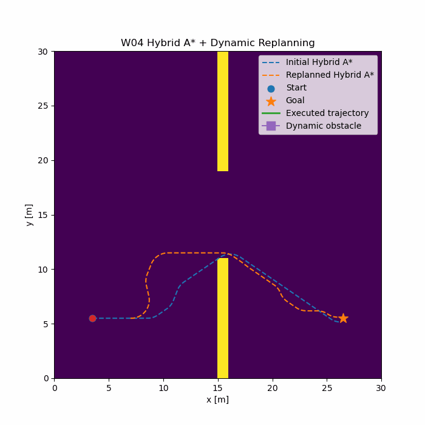
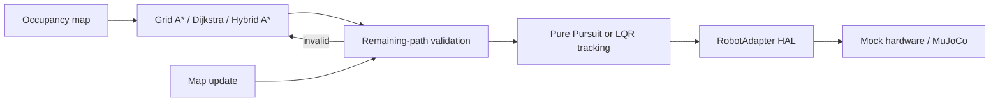

# EmbodiedSwarm

EmbodiedSwarm is an engineering portfolio for embodied-robot planning, control,
and simulation. The current stack spans project-owned robot interfaces,
deterministic and MuJoCo backends, classical grid navigation, continuous-pose
Hybrid A*, minimal online replanning, and closed-loop path tracking. Multi-robot
coordination and manipulation planning remain explicit roadmap items.



## What is implemented

- **Robot contracts:** validated `RobotState` and `RobotCommand` models plus a
  backend-neutral `RobotAdapter` HAL.
- **Executable backends:** deterministic mock hardware and a headless MuJoCo
  mobile-base / Panda-compatible arm skeleton.
- **Classical navigation:** `OccupancyGrid`, Dijkstra, A*, Bresenham
  line-of-sight, collision-aware path simplification/smoothing, and Pure
  Pursuit tracking.
- **Hybrid A\* (W04):** continuous `(x, y, yaw)` propagation, yaw discretization,
  three forward unicycle motion primitives, per-primitive collision checking,
  Euclidean heuristic search, turn penalty, and continuous path reconstruction.
- **Dynamic replanning (W04):** remaining-path validation after an occupancy-map
  update and replanning from the robot's current pose when invalidated.
- **LQR tracking (W04):** lateral/yaw error model, discrete Riccati iteration,
  feedback-gain calculation, angular-rate feedback, saturation, and convergence
  validation.
- **Integrated navigation:** Hybrid A* plan -> Pure Pursuit tracking -> dynamic
  obstacle injection -> inflated map update -> online replan -> goal-region
  arrival, with an executable GIF artifact.

## Architecture / pipeline



Project-owned state and command types form the boundary between algorithms and
backends. Navigation/control modules do not depend on MuJoCo internals.

## W04 planning results

Fresh sample run on Python 3.10.11 / Windows:

| Metric | Grid A* | Hybrid A* |
| --- | ---: | ---: |
| Path length | 35.0 m | 27.0 m |
| Expanded states | 248 | 732 |
| Planning time | 1.134 ms | 82.982 ms |
| Path representation | 36 grid nodes, 4 direction changes | 271 continuous samples, max yaw step 3.438 deg |

Command:

```bash
python -m demos.hybrid_astar_benchmark
```

These numbers describe the repository's fixed wall-and-opening scenario and are
hardware-dependent. Grid A* is substantially faster because it searches a
simple discrete state space. Hybrid A* spends more computation searching
`(x, y, yaw)`, but produces a shorter, heading-continuous trajectory in this
scenario. It is a planning trade-off, not a claim that Hybrid A* universally
outperforms grid search.

## Dynamic replanning

```text
OccupancyGrid update
    -> validate remaining path
    -> path invalid
    -> Hybrid A* from CURRENT pose
    -> new collision-free path
```

`path_is_collision_free()` checks the active remainder against the current
occupancy grid. `replan_if_needed()` keeps a valid path unchanged or invokes
Hybrid A* from the current pose and reports whether replanning succeeded. The
release demo replanned successfully after one injected obstacle (`72` expanded
states in the focused demo).

This is **minimal dynamic-obstacle replanning**. It reacts to a changed static
occupancy snapshot; it does not predict obstacle motion or solve a time-indexed
spatiotemporal planning problem.

## Tracking control

The LQR baseline uses the error state

```text
e = [e_y, e_yaw]^T
e(k+1) = A e(k) + B u(k)
u = -K e
```

where `u` is angular velocity. The discrete Riccati solution produces `K`; `Q`
weights tracking error and `R` weights control effort. Angular velocity is
saturated before the unicycle update.

Fresh controller benchmark:

| Metric | Pure Pursuit | LQR |
| --- | ---: | ---: |
| RMS lateral error | **0.3269 m** | 0.3468 m |
| RMS yaw error | 15.1886 deg | **12.2613 deg** |
| RMS control effort | 0.4251 rad/s | **0.3443 rad/s** |
| Settling time | 4.5 s | **3.7 s** |
| Final lateral error | -0.00013 m | 0.000012 m |

Both controllers converge in the fixed straight-line benchmark. Pure Pursuit
has slightly lower RMS lateral error; LQR settles faster with lower yaw error
and control effort. The result demonstrates different tuning trade-offs, not
complete dominance by either controller.

## Project structure

```text
embodied_swarm/core/        robot state, command, and frame transforms
embodied_swarm/hal/         RobotAdapter, mock hardware, MuJoCo adapter
embodied_swarm/navigation/  grid search, smoothing, Hybrid A*, replanning
embodied_swarm/control/     Pure Pursuit and LQR tracking
assets/mjcf/                mobile-manipulator MuJoCo model
ros2/                       reviewable ros2_control hardware skeleton
demos/                      smoke tests, benchmarks, and W04 integration
artifacts/                  generated W04 navigation GIF
tests/                      deterministic unit and integration regression
docs/                       architecture and milestone boundaries
```

## Quick start

Python 3.10 or newer is required.

```bash
python -m venv .venv
```

Windows PowerShell:

```powershell
.venv\Scripts\Activate.ps1
python -m pip install -e ".[dev,demo]"
```

Linux / macOS:

```bash
source .venv/bin/activate
python -m pip install -e ".[dev,demo]"
```

## Run tests

```bash
python -m pytest -q
```

Release regression: **161 tests passed** on Python 3.10.11, including focused
Hybrid A*, replanning, and LQR correctness/convergence coverage.

## Run W04 demos

```bash
python -m demos.hybrid_astar_benchmark
python -m demos.dynamic_replanning_demo
python -m demos.lqr_tracking_demo
python -m demos.controller_benchmark
python -m demos.w04_navigation_demo
```

The integrated demo regenerates
`artifacts/w04_navigation_replanning.gif`. MuJoCo foundation checks are also
available:

```bash
python -m demos.adapter_switch_smoke
python -m demos.mujoco_physics_smoke
```

## Engineering notes

- A collision-free geometric plan does not guarantee collision-free execution.
  Pure Pursuit can cut corners between path samples. The integrated W04 demo
  addresses the observed failure mode with one-cell obstacle inflation, a
  tighter `0.5 m` lookahead, and a lower `0.35 m/s` tracking speed, then checks
  the executed pose against the map at every control step.
- Hybrid A* currently uses a point-robot occupancy test, forward-only unicycle
  primitives, three steering rates, and a Euclidean heuristic. It has no reverse
  motion, analytic expansion, footprint polygon, or Reeds-Shepp heuristic.
- The LQR example is a linearized lateral/yaw controller for a constant-speed
  baseline. It does not include curvature feed-forward or a full dynamic model.
- The Panda-compatible MJCF is a project skeleton, not a claim of official
  Franka meshes, inertias, transmissions, gripper contacts, or certified control.
- The ROS2 directory is an unbuilt transport skeleton on this Windows release;
  real hardware support is not claimed.

## Roadmap

- Add footprint-aware Hybrid A*, reverse primitives, and a stronger
  nonholonomic heuristic.
- Add time-aware obstacle prediction and safe online velocity adaptation.
- Track curved paths with LQR feed-forward and compare controllers over several
  path families and noise levels.
- Add arm kinematics, collision-aware manipulation planning, and task-level
  navigation/manipulation sequencing.
- Add ROS2 runtime integration and only then begin real robot validation.
- Extend the single-robot stack with explicit multi-robot task allocation and
  conflict-aware planning benchmarks.

See [docs/architecture.md](docs/architecture.md) for contracts and limitations.
