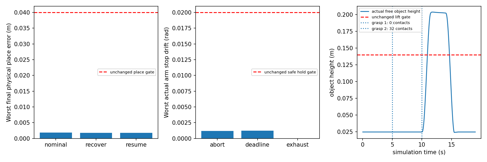
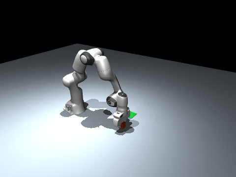

# Tickable behavior tree and physical recovery acceptance

Status: **PASS_REAL_SIM** for the minimum behavior-tree framework and this
bounded Panda task. This satisfies the behavior-tree framework option; symbolic
search is not an additional mandatory condition. The complete mobile/ROS
navigation-to-grasp-to-place chain remains **PARTIAL**. Hardware acceptance is
**PENDING_HARDWARE**.

## Reproduce

```bash
python3 -m pytest tests/test_bt.py -q
python3 -m demos.bt_pick_place --mode recover --seed 7 --render
python3 -m demos.bt_benchmark
python3 -m demos.bt_benchmark --no-render
python3 -m pytest -q
```

The existing sequential `TaskExecutor` remains available. This new executor
uses a memory behavior tree with explicit `RUNNING`, `SUCCESS`, `FAILURE` and
tree-level `ABORTED` states. `Sequence` advances after child success;
`Fallback` advances after child failure. An `Action` receives persistent local
memory and the shared blackboard on each tick. A `Condition` reads an actual
predicate. Successful/failed nodes and composite cursors remain latched, so this
is a **memory BT**, rather than a continuously re-evaluated reactive BT.

Nodes check the deadline/abort request before and after execution, including
between children of a composite. A failed root, action exception, clock fault,
operator abort or deadline invokes the stop callback once. Terminal ticks do
not repeat callbacks. Generic callbacks must perform bounded cooperative work;
this Python executor cannot forcibly interrupt an arbitrary blocking callback.

## Actual task and recovery branch

The tree runs on the unchanged `PandaSimulation` force/contact dynamics:

```text
Sequence: localize -> approach -> descend -> grasp fallback -> lift/verify
          -> transport -> place -> release -> retreat -> verify final pose

Fallback grasp:
  Sequence: close first -> verify finger/object contacts
  Sequence: fresh localization -> retreat -> fresh localization -> descend
            -> close retry -> verify finger/object contacts
```

Each motion action stores its start/target joint positions and interpolation
progress, then advances at most five 2 ms physical steps per invocation.
Composite ticks can invoke the ending action and the next starting action in
the same tick. Every individual step still passes through the existing unified
SafetySupervisor and Panda per-step simulation deadline check. IK and motion
targets use the existing 0.012 m Cartesian completion gate.

Failure injection actually keeps the first grasp's fingers open. The contact
predicate fails with **zero contacts**, which selects the Fallback recovery
branch. That branch queries the live object pose after failure and again after
retreat. The second physical closure must produce at least two finger/object
contacts, followed by actual free-object lift above **0.14 m**. Final place
acceptance retains horizontal error **< 0.04 m** and object z **< 0.04 m**.
The object is initialized with seed-dependent ±0.015 m xy perturbations; no
object pose is overwritten afterwards. There are no grasp flags or welds.

Object localization is explicitly **online simulator ground truth**, not a
camera/perception result. The arm scene has a fixed base and fixed place goal.
The existing mobile Panda demonstration remains a separate task.

## Persistent state boundary

`BehaviorTree.snapshot()` produces strict JSON-compatible node cursors,
action progress, blackboard, event history, original deadline and terminal
status. `restore()` validates tree identity, counters, node/event structure,
finite non-boolean clocks and the original clock domain before replacing state.
Malformed checkpoints leave the running tree unchanged.

The real `resume` experiment writes a checkpoint during descent at 2.5 s,
rebuilds the tree callbacks and restores the JSON state against **the same live
MuJoCo world and clock**. The original deadline is retained. Simulator state is
not reset, serialized or overwritten. This demonstrates task-state persistence;
it does **not** establish robot restart recovery, cross-process MuJoCo restore,
hardware re-homing or safe replay after physical-world movement. Checkpoints
are trusted local artifacts, not authenticated commands.

## Measured acceptance

Five seeds: **7, 17, 27, 37, 47**. MuJoCo 3.12.0, Python 3.10.12, WSL Ubuntu
22.04. Each row contains five independently initialized physical scenes.

| Scenario | Expected tree outcome | Physical result |
|---|---|---|
| Nominal | SUCCESS | 5/5 physical place tasks pass |
| Open-finger first grasp | SUCCESS after Fallback recovery | 5/5 fail with zero contacts, re-localize and physically regrasp/place |
| Persist/rebuild during descent | SUCCESS after restore and recovery | 5/5 preserve progress and finish place |
| Operator abort during descent | ABORTED | 5/5 safety latch and physical hold pass |
| 3 s task deadline during descent | ABORTED | 5/5 per-step deadline and physical hold pass |
| Both grasps physically kept open | FAILURE | 5/5 exhausted Fallback stops safely |

There are **15 completed place tasks, ten deliberate safe aborts and five
deliberate exhausted-grasp safe failures**. All 30 acceptance cases pass their
expected physical outcome; they are not 30 successful place tasks.

Worst final place error is **0.001891 m**. Minimum observed maximum object
height across completed tasks is **0.203499 m**. Successful-task joint tracking
RMSE is at most **0.021507 rad**. Worst actual stop drift is **0.001205 rad**,
below the existing **0.02 rad** safety hold gate. Deadline execution stops by
**3.002 s**, within the existing **3.004 s** substep boundary; operator abort is
polled at the BT tick boundary and occurs by **3.010 s** in this experiment.
These are simulation-time observations, not hardware or real-time guarantees.

For seed 7's recovery, first contact verification at 5 s reads 0 contacts and
0 N; the retry at 10 s reads 32 contact points and 2.188 N total normal force.
The actual free object then rises to 0.203518 m and finishes with 0.001723 m
horizontal error.





The GIF is `artifacts/bt/recover_seed_7.gif`. Each scene also saves a finite JSON
report, sampled physical trajectory JSONL and full tree checkpoint/events JSON.
Resume scenes save their intermediate checkpoint separately.

## Validation and remaining work

Unit checks cover RUNNING progress, memory Sequence/Fallback, terminal callback
idempotence, abort, failure stop, deadlines before the next action, persistence,
tree identity, invalid cursors, malformed nodes/events and nonfinite clocks.
Six real MuJoCo scenarios are also part of the module test suite. A negative
checkpoint test found that an explicit null node could bypass a presence check;
`checkpoint_validation_initial_failure.txt` retains that failed test result.
The implementation now distinguishes absent nodes from invalid present nodes.
Final module regression: **26 passed in 6.41 s** (`pytest_final.txt`). Final
whole-project regression: **268 passed in 24.20 s** (`pytest_full.txt`).

This module does not supply symbolic preconditions/effects, automatic task
planning, general retry policies, dynamic obstacle replanning, perception-based
object pose, distributed ROS BT nodes or the integrated encoder/IMU feedback
from the independent estimation experiment. The complete mobile/ROS chain and
flexible obstacle-goal execution remain separately unaccepted. Any later
capability expansion needs its own measured evidence; symbolic task search is
not required to recognize the implemented BT framework as accepted.
