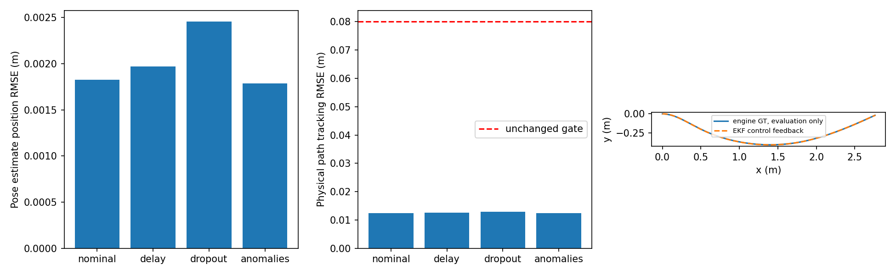
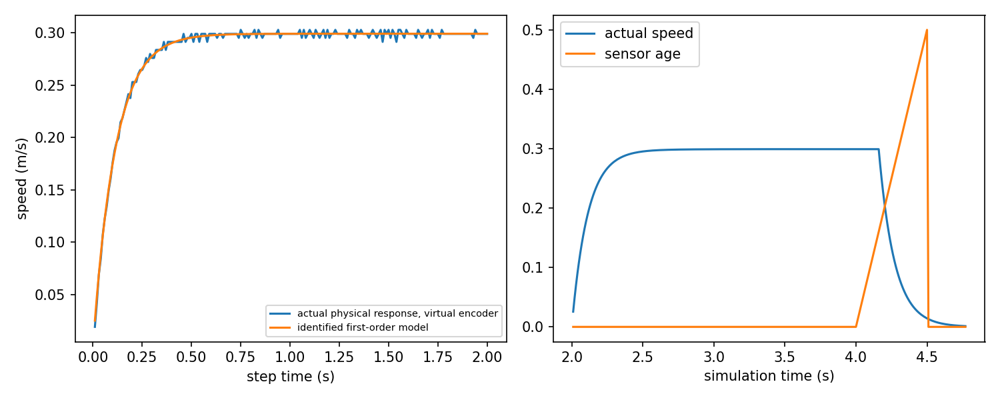

# Sensor-driven state estimation acceptance

Status: **PASS_REAL_SIM for the bounded planar experiment below**. The complete
W09 hardware-preflight milestone remains **PARTIAL**. Hardware calibration and
physical encoder/IMU validation are **PENDING_HARDWARE**.

This experiment replaces engine-pose feedback with an independent encoder/IMU
estimate. Actual MuJoCo force actuators move the existing planar base through a
curved path. The controller consumes only `EncoderImuEKF.state()`; engine pose
and velocity are read by the evidence writer after actuation for offline error
evaluation. Initialization uses a known, stationary simulation reset pose.

## Reproduce

From the repository root, with the existing demo dependencies installed:

```bash
python3 -m pytest tests/test_estimation.py -q
python3 -m demos.estimation_closed_loop --scenario delay --seed 7
python3 -m demos.estimation_benchmark
python3 -m demos.estimation_evidence_audit
python3 -m pytest -q
```

The committed benchmark ran under WSL Ubuntu 22.04, Python 3.10.12, MuJoCo
3.12.0 and NumPy 1.21.5. `artifacts/estimation/benchmark.json` contains every
run, configuration, acceptance threshold and host runtime percentile. The final
regression log is `artifacts/estimation/pytest_full.txt`: **242 passed in 16.87 s**.
The new module contributes **22 tests**, including five actual MuJoCo scenarios.

## Measurement and estimator contract

The generated `physical_base_sensors.xml` adds MuJoCo's built-in gyro,
accelerometer and velocimeter at the base IMU site. Encoder counts are an
explicitly **virtual** differential encoding of measured body forward velocity
and yaw rate, using radius 0.05 m, track 0.32 m and 4096 ticks/revolution. The
planar base has force actuators and **no physical wheels**. Wheel slip,
backlash, encoder electronics, unknown wheel radius and track are therefore
outside this acceptance result.

The sensor frontend samples at 100 Hz, injects gyro bias 0.025 rad/s, gyro
standard deviation 0.004 rad/s, acceleration standard deviation 0.008 m/s² and
encoder quantization with 0.2 tick Gaussian perturbations. Its packet contains
a measurement timestamp, monotonic sequence, cumulative left/right counts,
instantaneous gyro/acceleration and cumulative sampled IMU increments. Sensor
sampling continues during simulated **transport** loss; cumulative increments
retain the intervening samples. A real sampling outage cannot be repaired by
this contract and must trigger a freshness stop.

The EKF state is `[world x, world y, yaw, body vx, body vy, gyro_z bias]`.
Encoder count differences observe forward speed and yaw rate. Gyro/encoder
disagreement updates gyro bias. IMU increments predict pose and body velocity,
including the rotating-frame acceleration correction. A finite-difference
transition Jacobian and Joseph covariance update preserve a symmetric positive
semidefinite covariance in the numerical tests.

This force-driven base can move sideways during turns. Its identified actuator
response supplies the explicit model prior `vy ≈ -tau * omega * vx`; it is not
a universal wheel no-slip constraint. Measurement/process covariance settings
are configured assumptions, rather than an independently validated noise
model. The estimator has no engine pose, absolute position observation or
commanded-velocity input. Querying a delayed filter extrapolates a copy to the
controller time and preserves the original measurement age for safety checks.

Packets with future/stale timestamps, duplicates, reordering, invalid integer
encoding, nonfinite samples or implausible increments are rejected without
changing state, covariance or the last accepted timestamp. Reordered delayed
packets are rejected rather than retrospectively smoothed. The safety layer
latches a stop once accepted measurement age exceeds 0.15 s; later packets do
not automatically clear that latch.

## Simulation calibration and response identification

Each run first applies a real 0.3 m/s actuator step for two seconds, records
200 virtual encoder observations and fits
`v(t) = v_inf * (1 - exp(-t / tau))`. The actuator gain is independently
perturbed by a reproducible factor drawn from `[0.8, 1.2]`. Across the five
seeds the realized factors were 0.814–1.113, fitted time constants
0.09345–0.12665 s and fit residual RMSE 0.00244–0.00279 m/s. The filter receives
the fitted time constant, never the simulator's actuator parameter.

After reset, 200 stationary IMU packets estimate the z-axis gyro zero bias with
median/MAD outlier screening. The maximum error against the injected bias was
0.000343 rad/s; estimated standard errors were 0.000256–0.000303 rad/s.
Moving, unordered or insufficient calibration data, absent transients, flat
responses and inconsistent first-order fits fail explicitly.

These are **PASS_SIMULATED_CALIBRATION** and
**PASS_SIMULATED_IDENTIFICATION**. They do not establish wheel geometry,
accelerometer bias/scale, three-axis IMU alignment, temperature sensitivity,
gravity calibration, torque/friction identification or any hardware parameter.

## Closed-loop results and acceptance

Seeds: **7, 17, 27, 37, 47**. Existing navigation gates remain final physical
goal error `< 0.085 m` and physical path tracking RMSE `< 0.08 m`, with zero
obstacle contact. This experiment additionally requires estimator position
RMSE `< 0.06 m` and final actual speed `< 0.01 m/s`.

| Scenario | Physical outcome | Position RMSE mean / worst (m) | Tracking RMSE mean (m) | Worst final goal error (m) |
|---|---|---:|---:|---:|
| Nominal noisy sensors | 5/5 navigation PASS | 0.001827 / 0.002136 | 0.012503 | 0.049247 |
| 50 ± 10 ms transport delay/jitter | 5/5 navigation PASS | 0.001969 / 0.002343 | 0.012524 | 0.049223 |
| 20% stochastic transport loss | 5/5 navigation PASS | 0.002456 / 0.003331 | 0.012889 | 0.050364 |
| Future timestamp, count spike, NaN, duplicate | 5/5 navigation PASS | 0.001785 / 0.002057 | 0.012505 | 0.049182 |
| 500 ms transport outage | 5/5 safe abort PASS | 0.012635 / 0.013635 | 0.023286 | Goal deliberately ABORTED |

There were **20 successful navigation runs and five successful safety aborts**,
not 25 goal successes. All 25 runs had zero obstacle contact. Worst final actual
speed was 0.002416 m/s for navigation and 0.002229 m/s for the outage tests.
Navigation yaw estimation RMSE was at most 0.002565 rad. Measured per-run
estimator P99 was at most 0.900 ms for navigation and 1.938 ms for outage,
on this WSL host; it excludes controller/physics time and is not a Raspberry Pi
or real-time deadline measurement.





## Failures retained and evidence layout

Initial delay and dropout implementations failed: position RMSE was 0.0928 m
and 0.1810 m, with final goal errors 0.1103 m and 0.1865 m. The original
instantaneous-sample integration lost IMU increments and allowed lateral drift.
`initial_delay_failure.json` and `initial_dropout_failure.json` preserve those
failed measurements. Cumulative sampled increments and the independently fitted
lateral response prior corrected the model; the navigation gates were retained.
`initial_outage_estimator_drift.json` also preserves an earlier safety-abort run
with larger estimator drift. Historical failure files are reports, not a full
raw replay of the superseded implementation.

For each final scenario/seed the artifacts contain a finite JSON report,
trajectory JSONL, sensor generation/receipt JSONL, stationary calibration JSONL
and actuator step response JSONL. Logs record engine truth and estimator state
in distinct fields. An injected NaN remains NaN when passed to the filter; its
serialized packet uses `null` plus
`"nonfinite_fields": {"packet.gyro_z": "NaN"}` to preserve provenance in strict
JSON. A real anomalies rerun and a strict JSON parser test verify this contract.
`evidence_audit.json` records the strict parse result, restored-NaN count and
SHA-256 of every JSON/JSONL evidence file, including retained failures.

## Remaining W09 boundary

This accepts a short, planar, known-initial-pose experiment with a modeled
velocity-servo prior. Long-duration unbounded dead reckoning, absolute pose
correction, physical wheel slip, sensor sampling outages, six-axis IMU
calibration and real robot estimation remain unaccepted. The existing mobile
Panda task and ROS bridge do not automatically inherit this standalone EKF.
Their integration and validation are separate follow-up work. The full W09
milestone must remain **PARTIAL** until its remaining requirements have their
own measured evidence.
